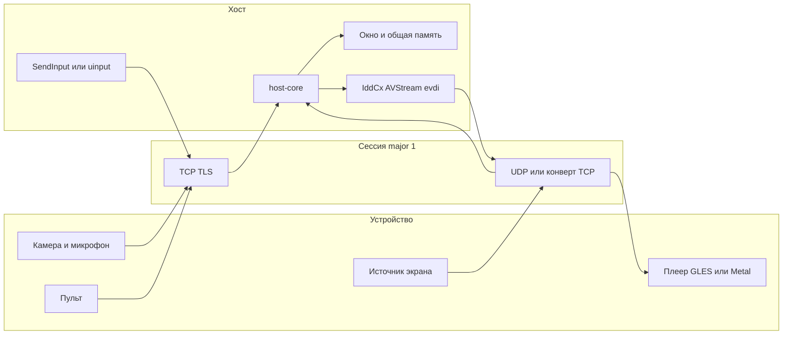

# Архитектура

Span соединяет устройство и компьютер в локальной сети или по кабелю. Устройство — агент на Objective-C. Общая логика хоста — Rust. Оболочки Windows и Linux тонкие.



Extend и Mirror не смешиваются. Extend забирает кадр у виртуального дисплея хоста и везёт его на устройство. Mirror забирает кадр у ReplayKit или, в Advanced, у framebuffer и показывает его окном на хосте.

Сборка iOS разделена на Legacy, Store и Advanced. Приватные API живут только в Advanced. Приёмник AirPlay не входит в схему, пока [ADR 0004](adr/0004-airplay-receiver.md) не принят.

Каталоги:

```
protocol/          спецификация, protobuf, пример пресета, векторы
host-core/         кодек span-protocol, дальше сессия
host-win/          оболочка и, позже, драйверы вне MIT
host-linux/        оболочка, evdi и v4l2loopback как отдельные процессы
ios/               три таргета, появятся со срезом сопряжения
tools/span-fuzzer  произвольные байты в парсеры
docs/              ADR и матрица
```

Порядок срезов записан в [ADR 0006](adr/0006-v1-slice.md).
